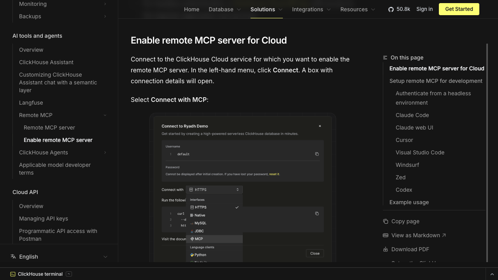

# ClickHouse Cloud setup reference

**Draft reference, not a tested catalog guide.** The image is a screenshot of [ClickHouse's public Remote MCP documentation](https://clickhouse.com/docs/products/cloud/features/ai-ml/mcp/remote-mcp#enable-remote-mcp-server), captured 2026-11-09. It contains a vendor-provided example of the Cloud **Connect with MCP** menu, not a screenshot from a Kaliper-connected account.

## Proposed customer path

1. Ask a ClickHouse service admin to open the intended running Cloud service and enable Remote MCP under **Connect → Connect with MCP**. The admin needs permission to manage MCP for that service.
2. In Kaliper, add ClickHouse Cloud and choose **Sign in with ClickHouse Cloud**.
3. Approve access with the ClickHouse user who can see that service.
4. Use **Test connection**, ask for accessible services and databases, then **Save and turn on**.

Before adding `connection.guide`, capture the actual admin and OAuth screens on a fresh account, verify the resulting tools, and have a second person complete this path. The public documentation screenshot must be replaced with a screenshot from that run.
