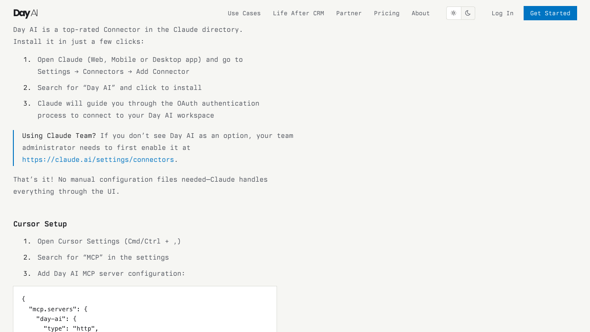

# Day AI setup reference

**Draft reference, not a tested catalog guide.** The image is a screenshot of [Day AI's public MCP setup page](https://day.ai/mcp), captured 2026-11-09. It describes a **Claude** connector and OAuth flow, not Kaliper's authorization screen.

## Proposed customer path

1. Confirm the Day AI workspace has the paid Agent tier and identify the agent to authorize.
2. In Kaliper, add Day AI and choose **Sign in with Day AI**.
3. Choose the intended workspace and agent in the Day AI authorization flow, then approve access.
4. Use **Test connection**, search for a known person or company, then **Save and turn on**.

Capture the actual workspace and agent selection screens on a fresh account, verify that the catalog exposes only read tools, and have a second person complete the path before adding `connection.guide`.
