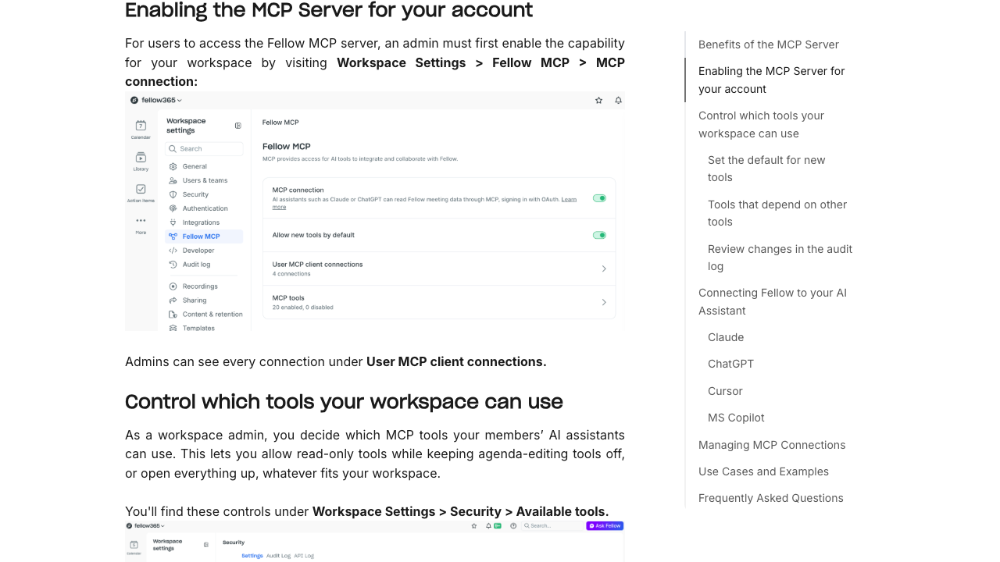

# Fellow setup reference

**Draft reference, not a tested catalog guide.** The image is a screenshot of [Fellow's public MCP help page](https://help.fellow.ai/en/articles/12622641-fellow-s-mcp-server#h_932a3d9dac), captured 2026-11-09. The settings image inside it was supplied by Fellow. It is not a screenshot from a Kaliper-connected workspace.

## Proposed customer path

1. Ask a workspace admin to open **Workspace Settings → Fellow MCP → MCP connection** and enable it.
2. In Kaliper, add Fellow and choose **Sign in with Fellow** using an account that can see the intended meetings.
3. Approve Fellow's authorization prompt.
4. Use **Test connection**, search for a known meeting, then **Save and turn on**.

Fellow also offers workspace tool controls. Confirm the exact labels, OAuth prompt, and meeting visibility on a fresh account; have a second person repeat the steps before adding `connection.guide`.
