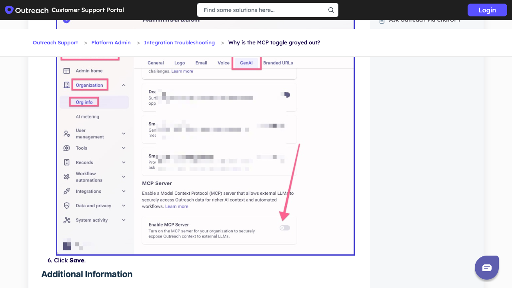

# Outreach setup reference

**Draft reference, not a tested catalog guide.** The image is a screenshot of [Outreach's public MCP support article](https://support.outreach.io/support/solutions/articles/159000429906-why-is-the-mcp-toggle-grayed-out-), captured 2026-11-09. Its embedded settings image was supplied by Outreach; it is not from a Kaliper-connected organization.

## Proposed customer path

1. Confirm the organization has Amplify access and the connecting user has an active Outreach seat.
2. Ask an Outreach admin to open **Administration → Organization → Org info → Gen AI**, enable **MCP Server**, and save.
3. In Kaliper, add Outreach and choose **Sign in with Outreach**. Approve the OAuth request with a user who can read the intended records.
4. Use **Test connection**, look up a known opportunity, then **Save and turn on**.

Capture the actual toggle and OAuth prompts on a fresh organization, check role-based access, and have a second person complete the path before adding `connection.guide`.
